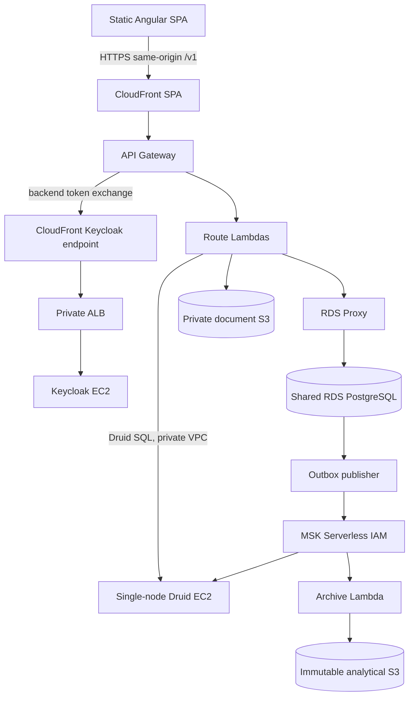

# Architecture

The platform separates transactional, event, identity, and analytical
responsibilities. API Gateway invokes small Python Lambdas; PostgreSQL remains
the operational source of truth; Kafka transports durable outbox events; Apache
Druid serves historical OLAP queries; and S3 retains a privacy-safe immutable
event archive.

## Runtime boundaries

- `src/functions`: Lambda/HTTP/event entry points.
- `src/shared/application`: use cases independent of infrastructure.
- `src/shared/domain`: validation, enums, and state transitions.
- `src/shared/adapters`: PostgreSQL, Kafka, Druid SQL, HTTP, and identity adapters.
- `analytics/druid`: pinned Druid image extension and Kafka supervisor specs.
- `db/migrations`: operational PostgreSQL schema.
- `frontend`: static Angular SPA with runtime URL configuration.
- `infra/terraform`: AWS networking, compute, identity origin, persistence,
  Kafka, archives, CloudFront, budgets, and deployment scripts.

## Identity and tenant boundary

Keycloak owns users, credentials, roles, sessions, and tokens. API Gateway uses
a Lambda auth facade for the custom login and a Lambda authorizer for protected
routes. Tokens remain in HttpOnly cookies; unsafe requests also require a signed
CSRF token. Every business handler repeats its required-role check.
Repository queries and Druid queries inject the tenant from verified claims;
tenant scope is never trusted from a request body or query string.

On AWS, Keycloak and Druid run on different private EC2 instances and share the
physical RDS instance only for cost. A bootstrap Lambda creates separate logical
databases, users, and Secrets Manager values. Neither EC2 instance accepts
public ingress. CloudFront reaches Keycloak through a VPC Origin and the SPA
through Origin Access Control to private S3.

## Consistency and failure model

The operational transaction and event intent are atomic, but broker delivery is
at least once. Consumers use stable `event_id` values for idempotency. Druid and
the raw archive consume independently, so either can recover without blocking
the other. Analytical freshness is eventual and targets 60 seconds; committed
academic operations remain successful during an analytical delay.

Archive keys are deterministic and S3 writes are create-only. A replay of an
already archived `event_id` is therefore idempotent and cannot overwrite the
original privacy-filtered record.

The accepted decisions are recorded in ADR-008 through ADR-025. ADR-008
supersedes the earlier Glue/Redshift analytical engine in ADR-007 while retaining
the immutable archive and transactional-outbox principles.
