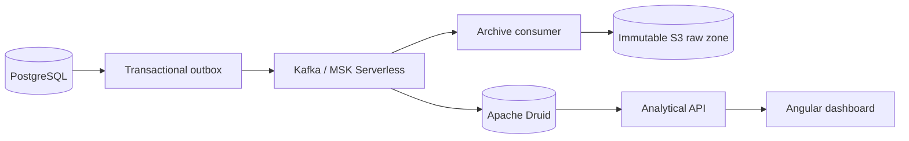

# Persistence and OLAP

## Operational model

PostgreSQL is the transactional source of truth for requests, documents,
reviews, notifications, optimistic versions, and the outbox. A request or review
mutation and its event intent commit in one transaction. The publisher claims
pending rows with `FOR UPDATE SKIP LOCKED`, publishes with `acks=all`, and records
`published_at`; failures remain retryable.

Document bytes stay in private S3. PostgreSQL stores metadata only, and every
upload/download uses a short-lived presigned URL after tenant and owner/role
authorization.

## Analytical path

Druid uses native Kafka streaming ingestion and normally exposes accepted events
within 60 seconds. The analytical API never queries operational tables and the
browser never sends a copy of requests for aggregation. An analytical outage
therefore cannot roll back a committed academic transaction.

The S3 consumer is independent from Druid. It writes one deterministic object
per `event_id`, partitioned by event type and event time. Actor and student
sources are salted and hashed before persistence. Names, emails, codes,
observations, documents, tokens, and reviewer identities are excluded.
Writes use the S3 create-only precondition, so a replay can acknowledge an
existing event but cannot replace it. Bucket versioning provides an additional
recovery trail.

## Event-state reconstruction

Submission and review contracts are version 2. Every review event is
self-contained with request type, course pair, credits, decision, reviewer role,
submission time, and review time. Druid does not join to PostgreSQL.

The request and equivalence cubes group by stable `request_id` and use
`LATEST_BY(value, __time)` to reconstruct the latest state. This prevents status
events from double-counting requests. Review processing uses one row per unique
review event. The supported views are:

- request outcomes by year, month, tenant, type, and status;
- course equivalences by source course, target course, status, and credits;
- processing time by year, month, tenant, reviewer role, and decision.

All SQL identifiers come from server allow lists. Values use Druid SQL
parameters. Non-administrator calls always inject the tenant from the verified
token; a browser-provided tenant is rejected.

## Local oracle

`scripts/seed_demo.py` is restricted to `APP_ENV=local|dev`, uses stable UUIDv5
identifiers, and is idempotent. Its expected totals are in
`analytics/demo-expected.json`. It inserts operational and outbox rows only, so
the same Kafka ingestion, archive, and Druid code is exercised by both demo and
live writes.

Terraform invokes the same generator once inside the private VPC when
`load_demo_dataset=true`. A configuration guard permits that option only for a
complete `dev` deployment with persistence and MSK enabled.

## Recovery and retention

Operational recovery uses RDS backups/snapshots. Druid deep storage and the raw
archive use S3. Kafka retention covers short replay windows, while the raw zone
is the durable analytical replay source. The dev Terraform lifecycle expires
archive versions after seven days and destroys non-production data during the
approved teardown because the dataset is reproducible.
