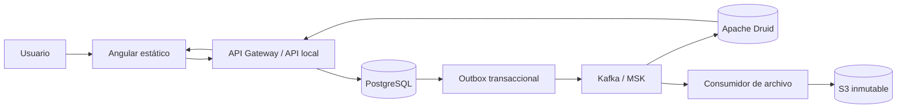
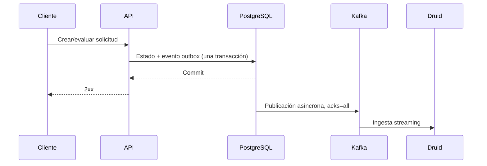
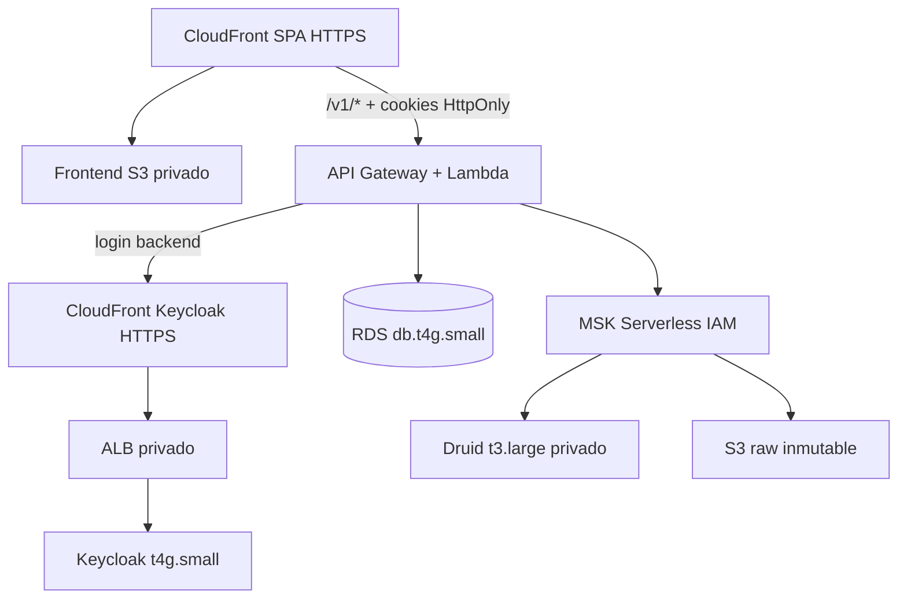

# Presentación final: cubo OLAP de solicitudes académicas

Documento base en español para diapositivas, exposición y demostración. Los
artefactos técnicos del repositorio permanecen en inglés según ADR-004.

## Diapositiva 1 — Objetivo

Implementar análisis histórico de solicitudes académicas sin cargar el sistema
transaccional ni exponer información personal.

- PostgreSQL conserva la operación diaria.
- Kafka desacopla los cambios del procesamiento analítico.
- Apache Druid implementa el cubo OLAP en tiempo casi real.
- S3 conserva un archivo inmutable y seudonimizado para auditoría/reproceso.
- Angular muestra métricas y tres perspectivas del cubo.

Mensaje clave: **la analítica puede retrasarse o fallar sin revertir una
solicitud académica ya confirmada**.

## Diapositiva 2 — Problema inicial

El tablero anterior recibía desde el navegador una lista de solicitudes y
calculaba un resumen pequeño. Esto impedía:

- analizar doce meses de historia;
- hacer drill-down por fecha, tenant, curso, estado o rol;
- garantizar que el origen fuera el repositorio analítico;
- separar rendimiento operacional y analítico;
- reconstruir o auditar los datos desde eventos.

La ruta antigua `POST /analytics/summary` fue retirada. La ruta actual es
`GET /analytics/summary` y consulta exclusivamente Druid.

## Diapositiva 3 — Arquitectura



Explicación sugerida: la misma transacción que cambia una solicitud crea la
intención de evento. Un publicador asíncrono lleva el evento a Kafka. Druid y S3
lo consumen con grupos independientes.

## Diapositiva 4 — Consistencia y privacidad



- Entrega al menos una vez; `event_id` estable permite idempotencia.
- No llegan a Druid nombres, correos, códigos, observaciones ni documentos.
- El archivo S3 aplica hash con salt al actor/estudiante.
- La escritura condicional de S3 impide reemplazar un evento ya archivado.
- El tenant se toma del token Keycloak, no del navegador.

## Diapositiva 5 — Modelo del cubo

| Perspectiva | Grano | Dimensiones | Medidas |
|---|---|---|---|
| Solicitudes | última versión por solicitud | año, mes, tenant, tipo, estado | total, aprobadas, rechazadas, tiempo de resolución |
| Equivalencias | solicitud por par de cursos | origen, destino, estado, fecha | casos y créditos solicitados/aprobados |
| Procesamiento | evento de revisión | fecha, tenant, rol, decisión | revisiones y tiempo de respuesta |

Druid reconstruye el estado con `LATEST_BY(valor, __time)` agrupado por
`request_id`. Así, una solicitud con varias revisiones cuenta una sola vez en el
cubo de resultados, pero cada revisión cuenta en el cubo de procesamiento.

## Diapositiva 6 — Contrato de eventos v2

Los eventos de revisión se enriquecieron dentro de la transacción con:

- tipo de solicitud;
- curso y créditos de origen/destino;
- estado anterior/nuevo y decisión;
- rol revisor;
- fecha de envío y fecha de revisión.

Esto hace que Druid sea autónomo: no consulta PostgreSQL para completar eventos.
Los contratos v1 no fueron reinterpretados; se introdujeron tipos v2 explícitos.

## Diapositiva 7 — Dataset demostrativo

El comando `docker compose --profile seed run --rm demo-seed` genera:

- 300 solicitudes deterministas;
- 270 revisiones;
- 12 meses, desde diciembre de 2025 hasta noviembre de 2026;
- 100 solicitudes para Sistemas, Minas y Electrónica;
- seis pares de cursos;
- ciclos de solicitud de cambios y distintos roles revisores.

Resultado validado localmente:

| Estado final | Cantidad |
|---|---:|
| Aprobada | 120 |
| Rechazada | 60 |
| Requiere ajustes | 60 |
| Enviada | 60 |

Otros resultados: 90 eventos de ajuste, aprobación de 66,67 % sobre decisiones
y 51,73 horas promedio de resolución.

## Diapositiva 8 — Demostración local

1. Abrir <http://localhost:8888> y mostrar el datasource `academic_events`.
2. Mostrar que el supervisor está `RUNNING`, saludable y con lag 0.
3. Entrar al portal <http://localhost:4200> como `analista.sistemas`.
4. Abrir el tablero y señalar la etiqueta “Apache Druid”.
5. Mostrar los tres cubos y el drill-down mensual.
6. Crear/evaluar una solicitud y refrescar después de la ventana de ingesta.
7. Mostrar el outbox publicado y el objeto del archivo S3Mock.

Comandos de respaldo:

```bash
curl -fsS http://localhost:8888/druid/indexer/v1/supervisor/academic_events/status
docker compose exec -T api python -c \
  "from shared.adapters.druid import summary_for_tenant; print(summary_for_tenant(None))"
```

## Diapositiva 9 — Despliegue AWS



- Región: `us-east-1`, ambiente `dev`.
- Instancias on-demand y tamaños variables en Terraform.
- Keycloak y Druid comparten RDS físico por costo, con bases/usuarios/secretos
  separados.
- Ninguna EC2 recibe tráfico público; Keycloak usa CloudFront VPC Origin.
- La SPA usa S3 privado + Origin Access Control; `/v1/*` comparte su hostname
  CloudFront para usar cookies seguras sin redirección.
- Lambdas privadas inicializan tópicos, bases y dataset demo sin abrir endpoints
  administrativos.

## Diapositiva 10 — Costo y control

Los USD 120 promocionales reducen el pago directo, pero no convierten los
servicios en gratuitos. MSK Serverless, NAT Gateway, RDS, ALB y EC2 pueden
consumir crédito continuamente.

Controles adoptados:

- entorno completo máximo 48 horas;
- prioridad a facilidad de demostración y costo, no alta disponibilidad;
- alertas de AWS Budgets en USD 25, 50 y 80;
- plan y estimación revisados antes de aplicar;
- destrucción Terraform obligatoria después de la presentación;
- dataset reconstruible, por lo que no se retiene infraestructura costosa.

Estimación previa para 48 horas: aproximadamente USD 50–55, con un techo de
aprobación de USD 65 por contingencia. Los USD 120 de crédito deberían cubrir
una ejecución, pero no se consideran garantía ni capa gratuita.

## Diapositiva 11 — Seguridad de despliegue

El acceso humano usa AWS IAM Identity Center:

```bash
aws configure sso --profile academic-demo
aws sso login --profile academic-demo
AWS_PROFILE=academic-demo aws sts get-caller-identity
```

No existen access keys permanentes en el proyecto. La sesión SSO ya fue
configurada, pero el despliegue permanece detenido hasta elegir la cuenta,
verificar región y vigencia del crédito, regenerar el plan, revisar costos y
obtener aprobación explícita.

El login visible pertenece al portal y Keycloak conserva usuarios y roles. Los
tokens viajan solo en cookies `HttpOnly` y las mutaciones requieren CSRF. Direct
Grant es una excepción académica documentada en ADR-025; producción debe volver
a Authorization Code + PKCE. CloudFront agrega CSP, HSTS y anti-framing.

## Diapositiva 12 — Evidencia y estado

Evidencia local completada el 25 de noviembre de 2026:

- 35 pruebas Python y 19 pruebas Angular aprobadas;
- imagen API construida;
- Angular 22 compilado como SPA estática y servido por Nginx;
- supervisor Druid saludable, dos particiones, lag agregado 0;
- 570 eventos v2 ingeridos (300 envíos + 270 revisiones);
- resumen Druid coincidente con el manifiesto esperado;
- 48 filas del cubo de solicitudes, 252 de equivalencias y 65 de procesamiento;
- login propio respaldado por Keycloak, con tokens en cookies `HttpOnly`, y
  cuatro consultas HTTP analíticas con respuesta 200;
- escritura repetida en S3Mock validada como duplicado, sin sobrescritura;
- Terraform con proveedor AWS 6.74 validado correctamente.

Estado AWS: **preparado pero no aplicado**. SSO está configurado; falta decidir
la cuenta, revisar crédito/costo, configurar el correo de presupuesto, generar
un plan nuevo y obtener aprobación. El plan anterior quedó inválido por
ADR-025. Esta pausa es un control deliberado, no una limitación técnica.

## Decisiones trazables

| Tema | ADR |
|---|---|
| Druid como motor canónico | [ADR-008](ADR-008-druid-olap-platform.md) |
| Druid en una EC2 | [ADR-009](ADR-009-single-node-druid-on-aws.md) |
| MSK Serverless + IAM | [ADR-010](ADR-010-msk-serverless-iam-for-druid.md) |
| Modelo y privacidad | [ADR-011](ADR-011-analytical-model-and-event-enrichment.md) |
| Archivo inmutable | [ADR-012](ADR-012-immutable-analytical-event-archive.md) |
| Corte limpio de API | [ADR-013](ADR-013-clean-analytical-api-cutover.md) |
| Perfil local | [ADR-014](ADR-014-local-analytics-resource-profile.md) |
| Despliegue y aprobación | [ADR-015](ADR-015-aws-deployment-target-and-approval-gate.md) |
| Alcance AWS completo | [ADR-016](ADR-016-complete-aws-hosting-scope.md) |
| HTTPS CloudFront | [ADR-017](ADR-017-cloudfront-generated-public-hostnames.md) |
| Angular estático | [ADR-018](ADR-018-static-angular-on-s3-and-cloudfront.md) |
| Keycloak y RDS compartido | [ADR-019](ADR-019-dedicated-keycloak-ec2-with-shared-rds.md) |
| Tamaños por costo | [ADR-020](ADR-020-cost-oriented-aws-sizing.md) |
| Créditos y 48 horas | [ADR-021](ADR-021-ephemeral-aws-demo-with-credit-budget.md) |
| Dataset determinista | [ADR-022](ADR-022-deterministic-synthetic-analytical-dataset.md) |
| Presentación en español | [ADR-023](ADR-023-spanish-presentation-package.md) |
| Acceso AWS con SSO | [ADR-024](ADR-024-aws-sso-for-deployment-access.md) |
| Login propio y excepción Direct Grant | [ADR-025](ADR-025-custom-login-keycloak-bff.md) |

## Cierre sugerido

“El resultado no es solo un tablero: es una separación verificable entre la
operación y la analítica. Cada indicador puede rastrearse hasta eventos Kafka,
consultarse en Druid, recuperarse desde S3 y desplegarse en AWS sin exponer las
instancias ni guardar credenciales permanentes.”
